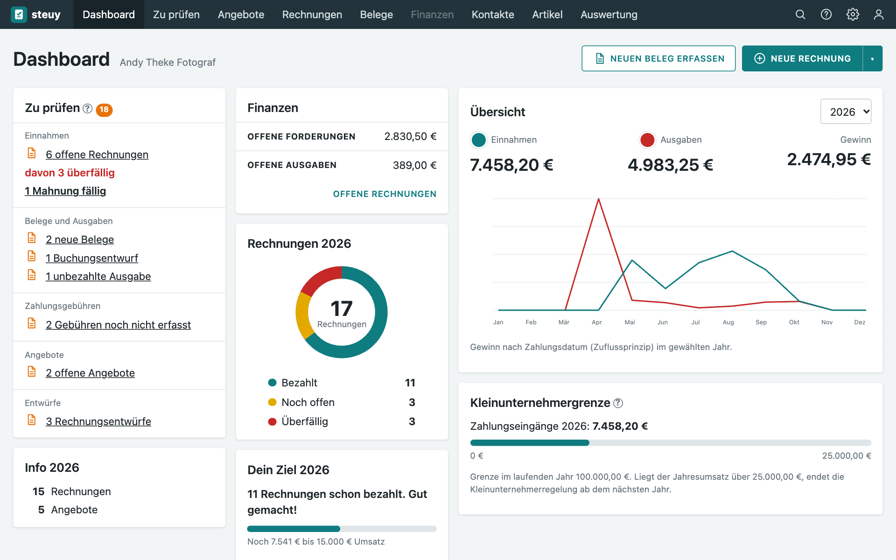
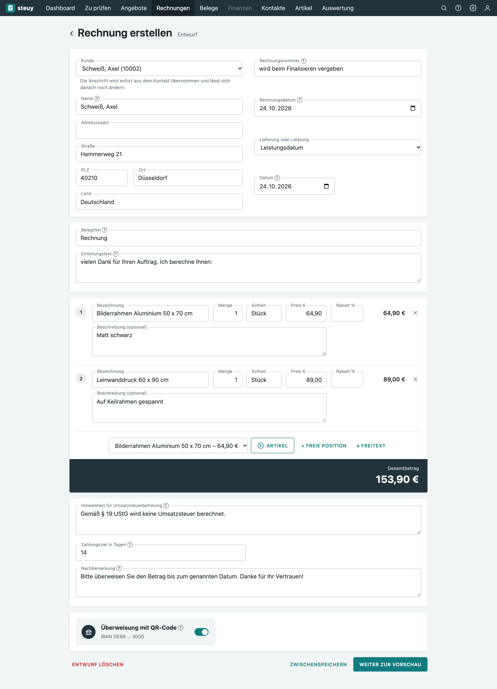
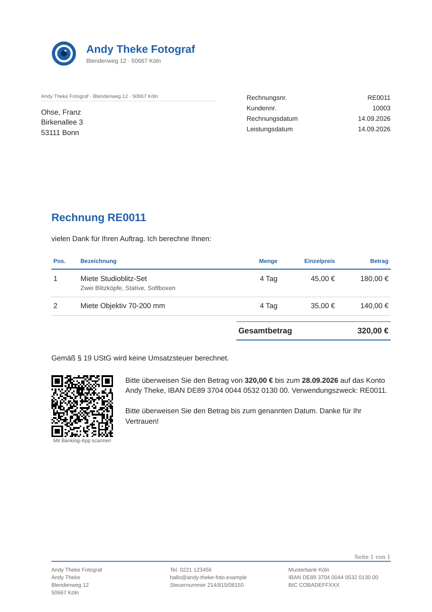
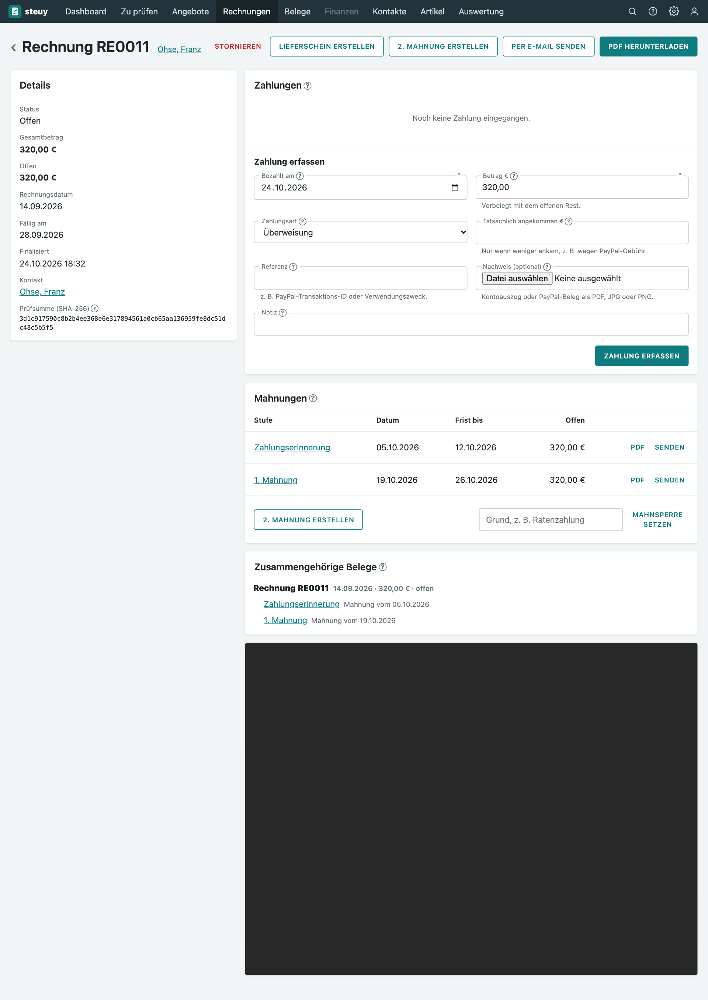
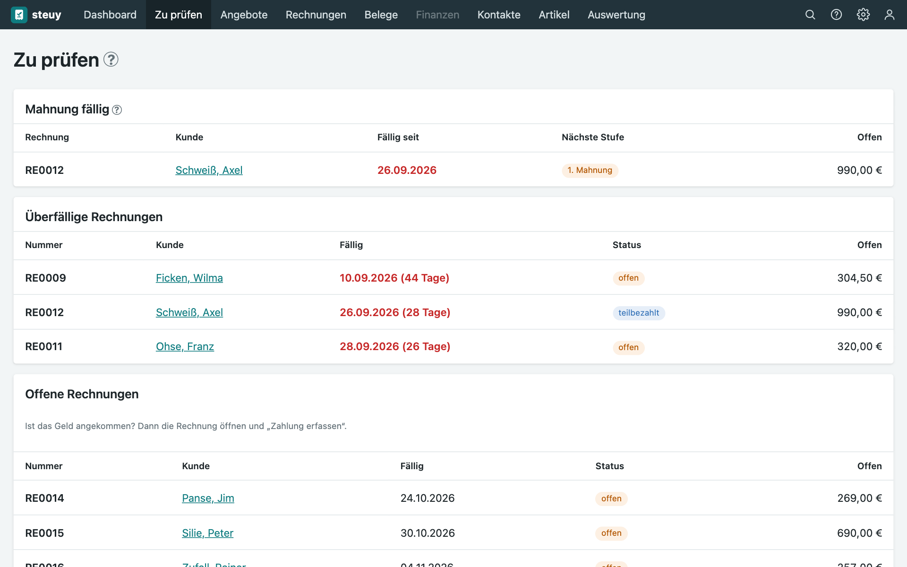
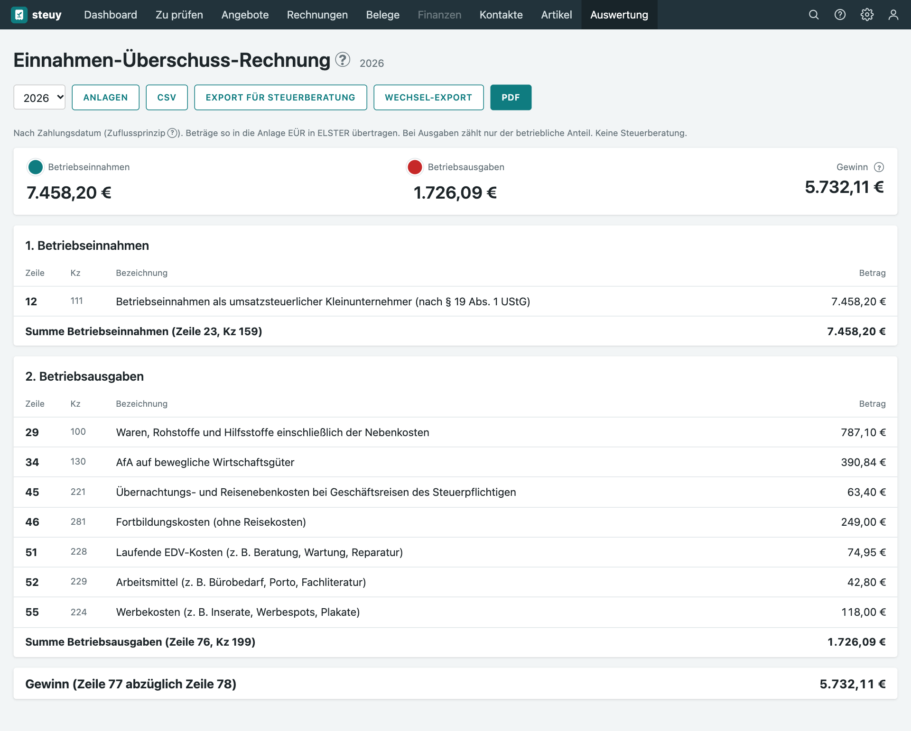
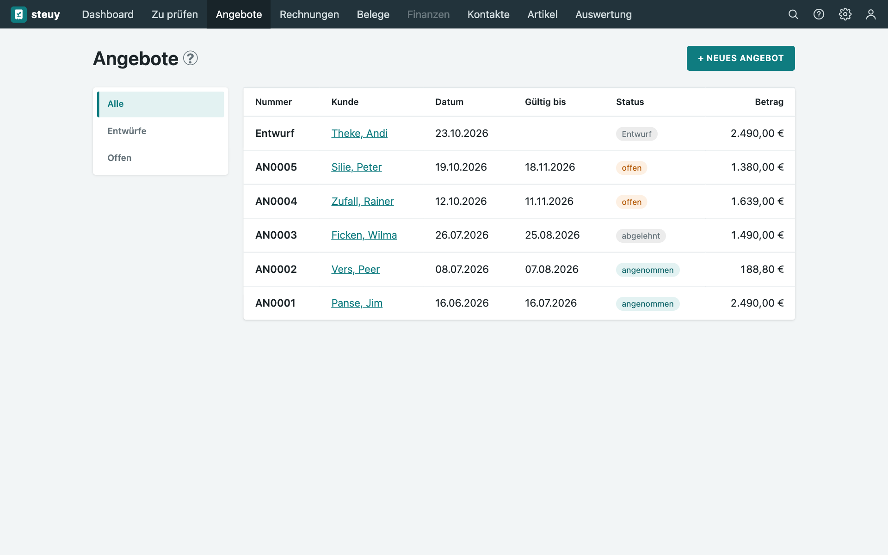
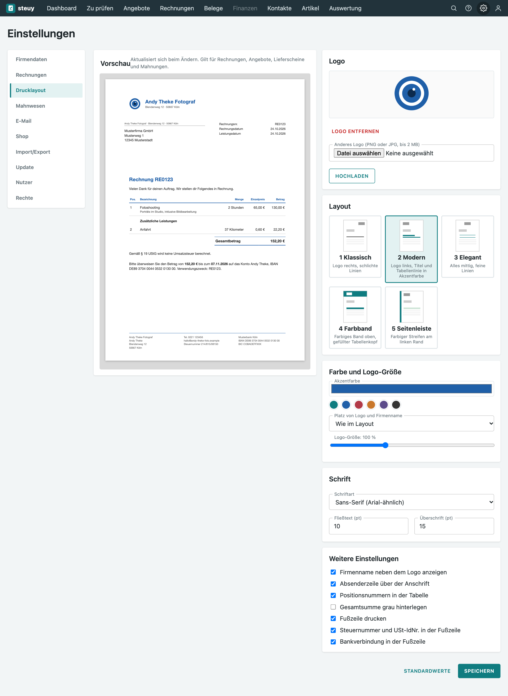

<div align="center">

<picture>
  <source media="(prefers-color-scheme: dark)" srcset="docs/bilder/steuy-logo-dunkel.svg">
  
</picture>

Buchhaltung für Kleinunternehmer, kostenlos und auf dem eigenen Rechner.


<a href="https://steuy.philsit.de"></a>

[Screenshots](#screenshots) · [Installieren](#installieren) · [Anleitung für Einsteiger](docs/thinclient.md) · [Dokumentation](#dokumentation)

</div>

steuy ist eine Buchhaltung für Kleinunternehmer nach § 19 UStG, die ihren Gewinn per Einnahmen-Überschuss-Rechnung (EÜR) ermitteln. Du schreibst Angebote und Rechnungen, legst Belege ab, behältst Zahlungen und Mahnungen im Blick und bekommst am Jahresende die Werte für die Anlage EÜR.

steuy richtet sich vor allem an Einsteiger. Ein Rundgang erklärt beim ersten Start alle Bereiche, und Hilfetexte an den Feldern sagen, was wo hingehört. Die Software läuft auf deinem eigenen Rechner, zum Beispiel einem kleinen Thin Client im Heimnetz. Deine Daten verlassen ihn nicht: Es gibt keine Cloud und kein Konto bei uns.

## Live-Demo

<p align="center">
  <a href="https://steuy.philsit.de"></a>
</p>

Die Demo zeigt eine erfundene Musterfirma, einen Fotografen mit Rechnungen, Mahnungen, Belegen und Equipment-Vermietung. Ein Rundgang startet von selbst. Alle Änderungen werden alle 15 Minuten zurückgesetzt, bitte gib dort keine echten Daten ein.

## 🌱 Für Einsteiger gemacht

Du hast noch nie eine Buchhaltung geführt? Genau dafür ist steuy gebaut. Diese Funktionen helfen dir dabei:

- **Rundgang beim ersten Start.** steuy fragt nach deinen Vorkenntnissen (kompletter Anfänger, bereits mal gemacht, Experte) und zeigt dir passend dazu Schritt für Schritt, was wo ist und wofür du es brauchst. Du kannst ihn jederzeit im Profil neu starten.
- **Erklärungen direkt am Feld.** Ein kleines Fragezeichen neben Feldern und Fachbegriffen wie EÜR, Zuflussprinzip, Kleinunternehmergrenze oder Festschreiben erklärt sie in einfachen Worten. Wer sie nicht braucht, schaltet sie ab.
- **„Zu prüfen“ als Aufgabenliste.** Eine Seite sammelt alles, was noch zu tun ist: offene und überfällige Rechnungen, fällige Mahnungen, neue Belege, Entwürfe und unbezahlte Ausgaben.
- **Prüfungen, bevor etwas schiefgeht.** Vor dem Festschreiben einer Rechnung prüft steuy die Pflichtangaben. Unplausible Eingaben wie ein Belegdatum weit in der Zukunft oder eine falsch aufgebaute Steuernummer werden angemerkt.
- **Kleinunternehmerregelung im Blick.** Der Hinweis nach § 19 UStG steht automatisch auf jeder Rechnung, und das Dashboard zeigt, wie nah du an der Umsatzgrenze bist.
- **Belege per Foto.** Die Texterkennung liest Betrag und Datum aus und schlägt sie vor, du bestätigst nur noch.
- **Mahnungen ohne Nachdenken.** steuy sagt dir, wann eine Erinnerung fällig ist, und verschickt sie auf Wunsch automatisch.
- **Wöchentliche Zusammenfassung** per E-Mail, damit nichts liegen bleibt.
- **Updates und Sicherung per Klick**, ohne Kommandozeile.
- **Installation ohne Vorkenntnisse** mit der [Schritt-für-Schritt-Anleitung](docs/thinclient.md) für einen kleinen Thin Client.

## Funktionen

- **Angebote, Rechnungen und Lieferscheine** mit fortlaufenden Nummern, Artikeln und Kunden aus der Kontaktliste. Aus einem Angebot wird mit einem Klick eine Rechnung, die Belege bleiben miteinander verknüpft. Korrekturen laufen über Rechnungskorrektur oder Storno.
- **PDF/A** zum Archivieren, auf Wunsch mit QR-Code für die Überweisung, und Versand per E-Mail.
- **Drucklayout** mit fünf Vorlagen, eigenem Logo, Farben und Schrift, mit Vorschau beim Bearbeiten.
- **Zahlungen und Mahnwesen:** Zahlungseingänge und Teilzahlungen erfassen, offene Posten sehen, Mahnungen von Hand oder automatisch verschicken.
- **Belege und Ausgaben:** Belege hochladen oder fotografieren, die Texterkennung schlägt Betrag und Datum vor. Jede Datei wird mit Prüfsumme gespeichert und nie überschrieben.
- **EÜR und Dashboard:** Auswertung nach Zahlungsdatum (Zuflussprinzip), Jahresübersicht, Jahresziel und die Werte für die Anlage EÜR. Dazu Anlagegüter mit Abschreibung.
- **Umzug von Lexware:** Import aus dem DATEV-Archiv und aus CSV-Zahlungslisten.
- **WooCommerce:** Bestellungen aus dem eigenen Shop übernehmen.
- **Sicherheit und Nachvollziehbarkeit:** Rollen und Rechte, Zwei-Faktor-Anmeldung, festgeschriebene Buchungen lassen sich nicht mehr ändern (GoBD).
- **Updates aus der App heraus**, mit automatischer Sicherung vorher.

Eine Installation gehört genau einem Gewerbe. Alle Beträge werden auf den Cent genau gerechnet.

## Haftung

steuy ist keine Steuerberatung, die Nutzung erfolgt auf eigene Gefahr. Für Datenverlust, steuerliche Nachteile, falsche Werte oder Sicherheitslücken wird keine Haftung übernommen. Prüfe die Werte der Anlage EÜR vor der Abgabe selbst oder mit deiner Steuerberatung, übertragen wird von Hand in ELSTER. Und sichere deine Daten regelmäßig (siehe [Betrieb](docs/betrieb.md)).

## Lizenz

steuy steht unter der [PolyForm Shield License 1.0.0](LICENSE). Du darfst die Software in deinem Gewerbe nutzen, den Code lesen und anpassen. Nicht erlaubt ist, steuy oder eine Abwandlung davon als konkurrierendes Produkt oder als Dienst anzubieten. Sicherheitslücken meldest du bitte vertraulich, siehe [SECURITY.md](SECURITY.md).

## Screenshots

| | |
|---|---|
|  |  |
| Dashboard mit offenen Posten, Jahresziel und Rechnungsstatus | Rechnung erstellen |
|  |  |
| Rechnung als PDF im Layout „Modern“ | Rechnung mit Mahnungen und Zahlungen |
|  |  |
| Was noch zu erledigen ist | Einnahmen-Überschuss-Rechnung |
|  |  |
| Angebote | Drucklayout |

## Mindestanforderungen

steuy läuft auf jedem kleinen Linux-Rechner, der dauerhaft eingeschaltet bleibt: Mini-PC, gebrauchter Thin Client, Proxmox-Container oder Server.

| | Minimum | Empfohlen |
|---|---|---|
| Prozessor | 1 Kern, 64 Bit (x86_64) | 2 bis 4 Kerne |
| Arbeitsspeicher | 1 GB | 2 GB oder mehr |
| Speicherplatz | 10 GB | 20 GB oder mehr auf einer SSD, dazu Platz für Sicherungen |
| Betriebssystem | Debian 12 oder Ubuntu 24.04 | Debian 13 oder Ubuntu 24.04 und neuer |
| Netzwerk | LAN mit fester IP-Adresse im Heimnetz | zusätzlich ein zweites Gerät für Sicherungen |

Im Betrieb belegen App und Datenbank zusammen etwa 400 bis 700 MB Arbeitsspeicher. Am meisten Rechenleistung brauchen die PDF-Erzeugung und die Texterkennung, die sich abschalten lässt.

Ein gebrauchter Dell Wyse 5070 mit 4 bis 8 GB RAM und SSD passt gut und braucht wenig Strom. Ein Wyse 3040 geht auch, ist aber knapp: Er hat nur 2 GB RAM und 8 oder 16 GB fest verbauten Speicher, Sicherungen müssen auf ein externes Laufwerk.

## Installieren

Wenn du noch nie einen Server eingerichtet hast, nimm die [Anleitung für Einsteiger](docs/thinclient.md). Sie führt Schritt für Schritt vom leeren Thin Client oder Mini-PC bis zum laufenden steuy.

| Weg | Passt, wenn | Anleitung |
|---|---|---|
| Thin Client oder Mini-PC | du bei null anfängst | [docs/thinclient.md](docs/thinclient.md) |
| Proxmox-Container (LXC) | du schon einen Proxmox-Server hast | [docs/lxc.md](docs/lxc.md) |
| Docker | du einen Linux-Rechner mit Docker hast | unten, Details in [docs/betrieb.md](docs/betrieb.md) |
| Ohne Docker | du Python und PostgreSQL selbst verwalten möchtest | [docs/betrieb.md](docs/betrieb.md), Abschnitt „Ohne Docker“ |

Schnellstart mit Docker:

```sh
git clone https://github.com/faolan-exe/Steuy.git steuy && cd steuy
printf 'SECRET_KEY=%s\nPOSTGRES_PASSWORD=%s\n' "$(openssl rand -hex 32)" "$(openssl rand -hex 16)" > .env
docker compose up -d --build   # http://127.0.0.1:8000
```

HTTPS, Updates und Sicherungen beschreibt [docs/betrieb.md](docs/betrieb.md).

## Entwicklung

Voraussetzungen: [uv](https://docs.astral.sh/uv/), PostgreSQL 17 und Pango für die PDF-Erzeugung (ADR 0008). macOS: `brew install uv postgresql@17 pango tesseract`, Debian/Ubuntu: `apt install libpango-1.0-0 libpangoft2-1.0-0 tesseract-ocr tesseract-ocr-deu`. Tesseract ist optional und liest Belegfotos und Scans aus. PostgreSQL geht auch per Docker (siehe unten).

```sh
git config core.hooksPath .githooks
chmod +x .githooks/pre-push
uv sync
cp .env.example .env          # SECRET_KEY eintragen
createdb steuy
createdb steuy_test
uv run flask db upgrade
uv run flask run --debug      # http://127.0.0.1:5000
```

Der Hook blockt direkte Pushes auf `main` lokal.

PostgreSQL per Docker statt lokal:

```sh
docker compose -f docker-compose.dev.yml up -d
```

Dann die beiden Datenbank-URLs in der `.env` wie in `docker-compose.dev.yml` beschrieben setzen.

Tests und Lint:

```sh
uv run pytest
uv run ruff check . && uv run ruff format --check .
```

Beides läuft auch in der CI.

## Dokumentation

- [CONTRIBUTING.md](CONTRIBUTING.md): Regeln für die Mitarbeit
- [docs/thinclient.md](docs/thinclient.md): Installation für Einsteiger auf einem Thin Client
- [docs/betrieb.md](docs/betrieb.md): Betrieb, Sicherung und Wiederherstellung
- [docs/ziel.md](docs/ziel.md): Umfang und offene Fragen
- [docs/architektur.md](docs/architektur.md): Aufbau und Datenmodell
- [docs/domain/](docs/domain/): Fachregeln (GoBD, EÜR, Zahlungen, Rollen, WooCommerce)
- [docs/adr/](docs/adr/): getroffene Entscheidungen

---

Idee und Konzeption: [skyplayser](https://github.com/skyplayser). Umsetzung mit Claude AI.
