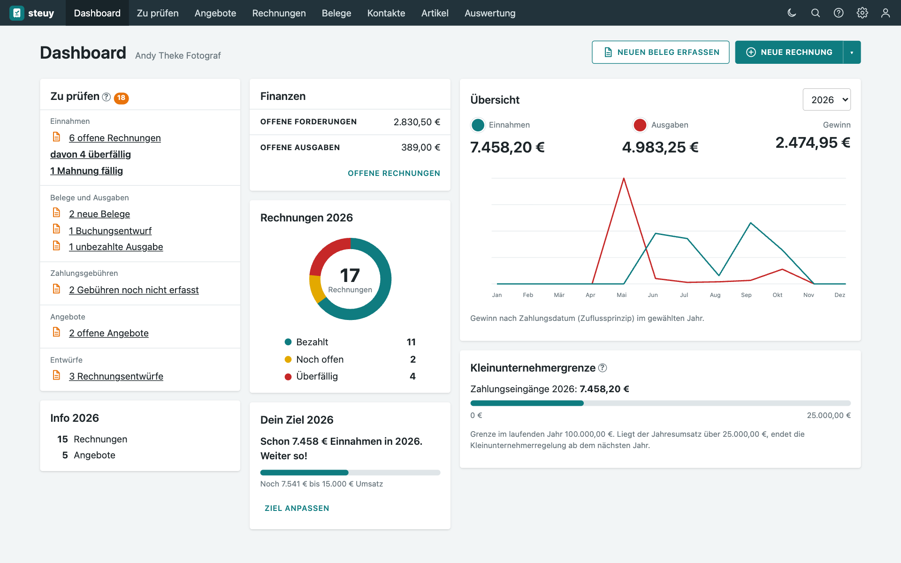
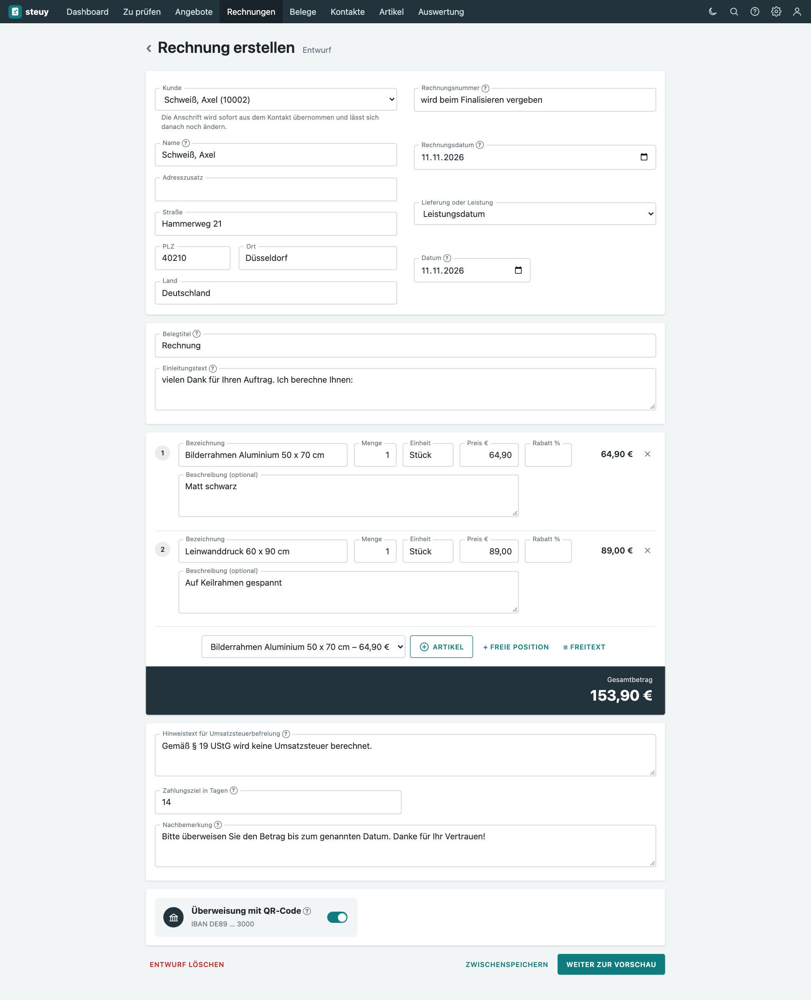
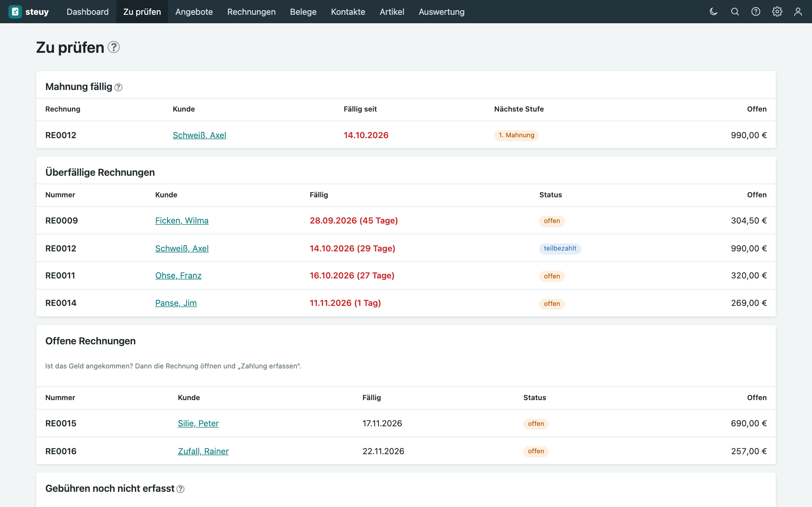
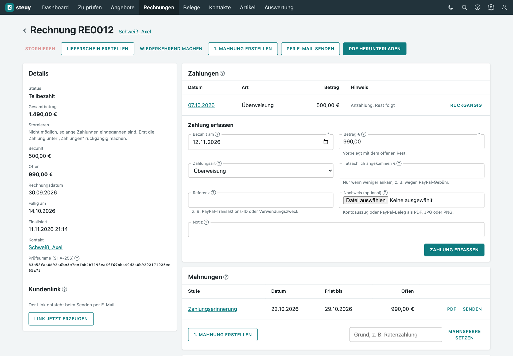
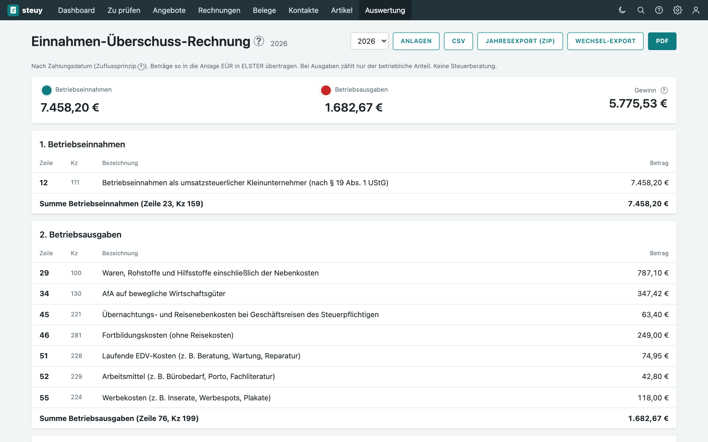
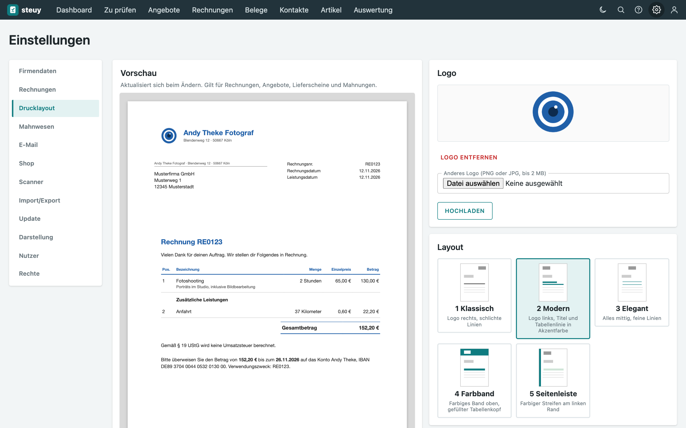
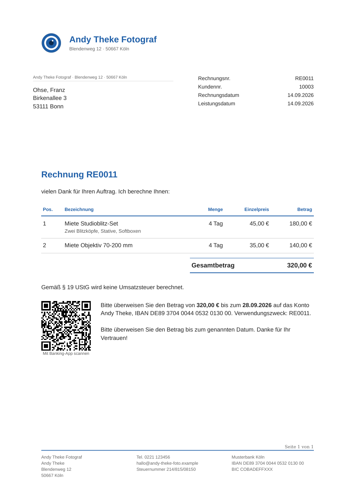
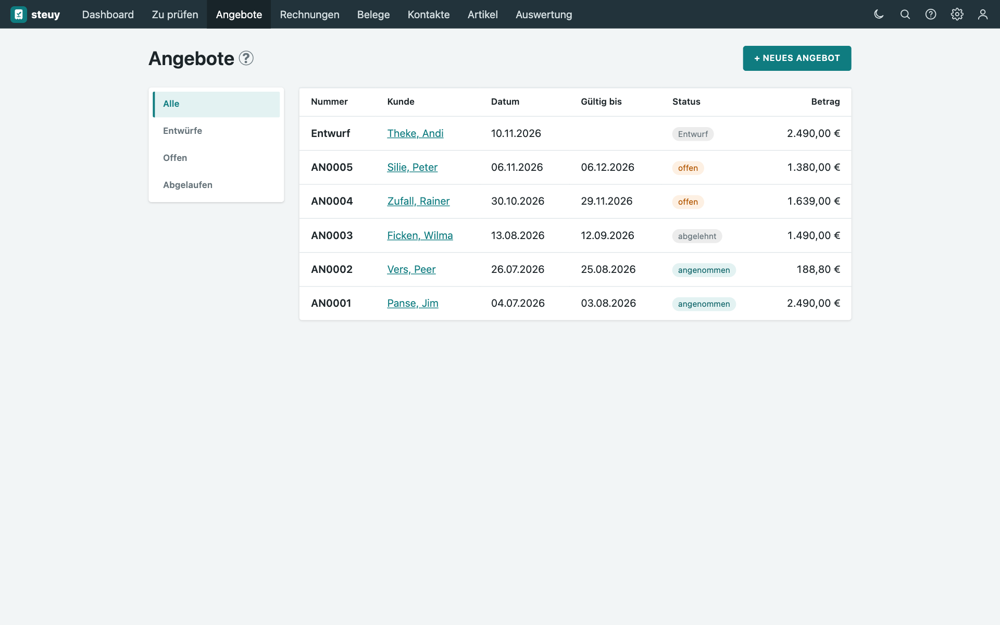
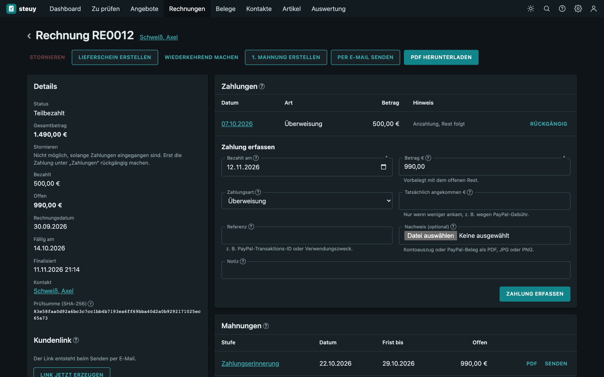

<p align="center">
  <picture>
    <source media="(prefers-color-scheme: dark)" srcset="docs/bilder/steuy-logo-dunkel.svg">
    
  </picture>
</p>

<h1 align="center">steuy: Buchhaltungssoftware für Kleinunternehmer, selbst gehostet</h1>

<p align="center">
  Rechnungen, Angebote, Mahnungen, Belege und EÜR auf deinem eigenen Rechner.<br>
  Kostenlos, ohne Abo, ohne Cloud. Für das Kleingewerbe nach § 19 UStG.
</p>

<p align="center">
  <a href="https://steuy.philsit.de">Live-Demo</a> &nbsp;·&nbsp;
  <a href="https://faolan-exe.github.io/Steuy/">Website</a> &nbsp;·&nbsp;
  <a href="https://faolan-exe.github.io/Steuy/doku/">Dokumentation</a> &nbsp;·&nbsp;
  <a href="#installieren">Installieren</a> &nbsp;·&nbsp;
  <a href="#erste-schritte">Erste Schritte</a> &nbsp;·&nbsp;
  <a href="docs/faq.md">Häufige Fragen</a> &nbsp;·&nbsp;
  <a href="docs/roadmap.md">Roadmap</a> &nbsp;·&nbsp;
  <a href="https://github.com/faolan-exe/Steuy/releases/latest">Was ist neu?</a>
</p>

<p align="center">
  <a href="https://github.com/faolan-exe/Steuy/releases/latest"></a>
  
  <a href="https://github.com/faolan-exe/Steuy/actions/workflows/ci.yml"></a>
  
  
  <a href="LICENSE"></a>
</p>

<p align="center">
  <a href="https://steuy.philsit.de"></a>
</p>

<picture>
  <source media="(prefers-color-scheme: dark)" srcset="docs/bilder/dashboard-dunkel.png">
  
</picture>

Wer klein anfängt, braucht keine Buchhaltung für Konzerne, sondern eine, die mitdenkt: Rechnung schreiben, Geld kommt an,
Beleg ablegen, und im Januar stehen die Werte für die Anlage EÜR da. steuy ist eine **Buchhaltungssoftware und ein
Rechnungsprogramm für Kleinunternehmer und Kleingewerbe** nach § 19 UStG, die ihren Gewinn per **Einnahmen-Überschuss-Rechnung
(EÜR)** ermitteln: Selbstständige, Freiberufler, Fotografen, Handwerker, Berater und kleine Online-Shops.

steuy läuft **auf deinem eigenen Rechner**, zum Beispiel einem gebrauchten Thin Client im Heimnetz oder einem
Proxmox-Container. Es gibt kein Konto bei uns, keine Cloud und keine Telemetrie. Nach außen spricht steuy nur, wenn du es
willst: E-Mails über deinen eigenen Mailserver, Bestellungen aus deinem WooCommerce-Shop, und einmal am Tag die Frage an
GitHub, ob es eine neue Version gibt (abschaltbar unter *Einstellungen → Update*).

> [!WARNING]
> **steuy ist in der Alpha-Phase.** Es läuft im echten Alltag, kann aber noch Fehler haben, und Datenmodell und Abläufe
> können sich ändern. Das Update per Klick sichert vorher automatisch, eine Sicherung auf einem zweiten Gerät gehört trotzdem
> dazu. Prüfe die Werte der Anlage EÜR vor der Abgabe selbst oder mit deiner Steuerberatung. steuy ist keine Steuerberatung.

## Funktionen

- **Angebote, Rechnungen, Lieferscheine:** fortlaufende Nummern, Kunden und Artikel aus der Liste (Artikel werden beim Tippen
  vorgeschlagen), aus dem Angebot mit einem Klick die Rechnung. Korrekturen laufen sauber über Rechnungskorrektur oder Storno.
  *Finalisieren und senden* in einem Schritt.
- **E-Rechnung, amtlich geprüft:** jede Rechnung als ZUGFeRD-PDF (EN 16931), für Behörden als XRechnung. Vor dem Festschreiben
  prüft steuy sie gegen dieselben Regeln wie das KoSIT-Prüftool. Eine fehlerhafte E-Rechnung wird gar nicht erst festgeschrieben.
- **Kundenportal:** Jede Mail enthält einen persönlichen Link. Dein Kunde sieht dort den Stand, lädt PDF und E-Rechnung,
  bezahlt per QR-Code den offenen Betrag und nimmt Angebote online an. Du siehst am Beleg, ob und wann er den Link geöffnet hat.
- **PDF/A mit eigenem Gesicht:** fünf Drucklayouts, dein Logo, deine Farben und Schrift, QR-Code für die Überweisung,
  Vorschau beim Bearbeiten.
- **Zahlungen und Mahnwesen:** Zahlungseingänge und Teilzahlungen, PayPal-Gebühren, offene Posten, Erinnerung und Mahnstufen
  von Hand oder automatisch. Überfällige Rechnungen sind rot markiert und haben einen eigenen Filter.
- **Wiederkehrende Rechnungen** für Abos und Dauerkunden, monatlich bis jährlich, mit Platzhaltern wie `{monat}`, auf Wunsch
  automatisch festgeschrieben und verschickt.
- **Belege ohne Zettelwirtschaft:** hochladen, fotografieren oder direkt vom Netzwerkscanner (z. B. Brother ADS-1800W).
  Die Texterkennung schlägt Betrag und Datum vor, jede Datei liegt mit Prüfsumme und wird nie überschrieben.
- **EÜR und Dashboard:** Auswertung nach Zahlungsdatum (Zuflussprinzip), Werte für die Anlage EÜR, Anlagegüter mit
  Abschreibung, Jahresziel und die Kleinunternehmergrenze immer im Blick.
- **„Zu prüfen“:** eine Seite mit allem, was noch zu tun ist: überfällige Rechnungen, fällige Mahnungen, neue Belege, Entwürfe.
- **Umzug von Lexware:** Import aus dem DATEV-Archiv und den Zahlungslisten. Danach zeigt steuy je Jahr, was noch fehlt, und
  setzt die Rechnungsnummern mit einem Klick fort.
- **WooCommerce:** Bestellungen aus dem eigenen Shop übernehmen.
- **Sicher und nachvollziehbar (GoBD):** festgeschriebene Rechnungen und Buchungen lassen sich nicht mehr ändern, jede Änderung
  steht im Protokoll. Rollen und Rechte, Anmeldung per [Passkey](docs/passkeys.md) oder Passwort mit Zwei-Faktor. Aus dem
  Internet ist steuy nur über HTTPS erreichbar, im Heimnetz auch ohne.
- **Hell oder dunkel:** folgt automatisch deinem System, Sonne/Mond oben rechts schaltet um, fest einstellbar unter
  *Einstellungen → Darstellung*.
- **Updates per Klick:** steuy sucht einmal am Tag nach einer neuen Version und installiert sie erst, wenn du bestätigst.
  Vorher legt es eine Sicherung an.

Eine Installation gehört genau einem Gewerbe. Alle Beträge rechnet steuy auf den Cent genau.

<table>
  <tr>
    <td width="50%"><br><sub><b>Rechnung schreiben.</b> Kunde wählen, Artikel antippen, fertig.</sub></td>
    <td width="50%"><br><sub><b>Kundenportal.</b> Der Kunde nimmt das Angebot online an.</sub></td>
  </tr>
  <tr>
    <td><br><sub><b>Zu prüfen.</b> Alles, was noch zu tun ist, an einer Stelle.</sub></td>
    <td><br><sub><b>Rechnung</b> mit Anzahlung, Mahnung und Kundenlink.</sub></td>
  </tr>
  <tr>
    <td><br><sub><b>EÜR</b> mit den Zeilen der Anlage EÜR.</sub></td>
    <td><br><sub><b>Drucklayout</b> mit Logo, Farben und Live-Vorschau.</sub></td>
  </tr>
  <tr>
    <td><br><sub><b>Die Rechnung als PDF</b> im Layout „Modern“, mit QR-Code.</sub></td>
    <td><br><sub><b>Rechnung im Kundenportal:</b> herunterladen und per QR-Code bezahlen.</sub></td>
  </tr>
  <tr>
    <td><br><sub><b>Angebote</b> mit Status und Gültigkeit.</sub></td>
    <td><br><sub><b>Dunkler Modus</b> für den Feierabend.</sub></td>
  </tr>
</table>

## Für Einsteiger gemacht

Du hast noch nie eine Buchhaltung geführt? Genau dafür ist steuy gebaut.

- **Rundgang beim ersten Start.** steuy fragt nach deinen Vorkenntnissen und zeigt dir passend dazu Schritt für Schritt, was
  wo ist und wofür du es brauchst. Im Profil startest du ihn jederzeit neu.
- **Erklärungen direkt am Feld.** Ein kleines Fragezeichen erklärt Fachbegriffe wie EÜR, Zuflussprinzip oder Festschreiben in
  einfachen Worten. Wer sie nicht braucht, blendet sie aus.
- **Prüfungen, bevor etwas schiefgeht.** Vor dem Festschreiben prüft steuy die Pflichtangaben. Unplausibles wie ein Belegdatum
  weit in der Zukunft oder eine falsch aufgebaute Steuernummer wird angemerkt.
- **Kleinunternehmerregelung im Blick.** Der Hinweis nach § 19 UStG steht automatisch auf jeder Rechnung, das Dashboard zeigt,
  wie nah du an der Umsatzgrenze bist.
- **Wöchentliche Zusammenfassung** per E-Mail, damit nichts liegen bleibt.
- **Installation ohne Vorkenntnisse** mit der [Schritt-für-Schritt-Anleitung](docs/thinclient.md), oder mit einem Befehl auf
  deinem Proxmox-Server.

## Kundenportal

Statt PDF-Anhang und „bitte überweisen Sie“ bekommt dein Kunde in jeder Mail zu Rechnung, Angebot, Lieferschein oder Mahnung
einen persönlichen Link. Dort sieht er, ob der Beleg offen, bezahlt oder überfällig ist, lädt PDF und E-Rechnung herunter,
bezahlt per QR-Code genau den offenen Betrag und nimmt ein Angebot mit Namen und Nachricht verbindlich an oder lehnt es ab. Du
bekommst sofort eine Mail und siehst am Beleg, wann der Link geöffnet wurde.

- Jeder Link ist ein langer Zufallsschlüssel. steuy speichert nur seinen Fingerabdruck, Links lassen sich einzeln sperren
  und neu erzeugen.
- Auf Wunsch fragt das Portal zusätzlich nach der Postleitzahl der Rechnungsadresse, nach fünf Fehlversuchen ist der Link für
  15 Minuten gesperrt.
- Die Seiten erscheinen in keiner Suchmaschine und geben beim Weiterklicken nichts preis.
- Dafür braucht steuy eine öffentliche https-Adresse. Wie du **nur das Portal** nach außen freigibst und der Rest im Heimnetz
  bleibt, steht in [docs/kundenportal.md](docs/kundenportal.md). Ohne Adresse verschickt steuy die Mails wie bisher ohne Link.

## E-Rechnung

Seit 2025 müssen Unternehmen E-Rechnungen empfangen können, das Ausstellen wird schrittweise Pflicht. Kleinunternehmer nach
§ 19 UStG sind vom Ausstellen ausgenommen, viele Kunden wünschen sie trotzdem. steuy kann beides.

| | Was steuy macht |
|---|---|
| **Ausstellen** | Jede Rechnung auf Wunsch als ZUGFeRD-PDF (Factur-X, Profil EN 16931): ein normales PDF mit den Daten maschinenlesbar darin. Bei Kunden mit Leitweg-ID als XRechnung, auch als reine XML-Datei. |
| **Prüfen** | Vor dem Festschreiben gegen das Schema und die amtlichen Prüfregeln von EN 16931 und XRechnung 3.0.2, dieselben wie im KoSIT-Prüftool. Verstößt eine Rechnung gegen eine Regel, nennt steuy sie und schreibt nicht fest. |
| **Empfangen** | Eingehende XRechnungen und ZUGFeRD-Rechnungen liest steuy ein und bewahrt sie im Originalformat auf. |

Ablauf und Grenzen: [docs/e-rechnung.md](docs/e-rechnung.md).

## Installieren

Was du brauchst: einen kleinen Linux-Rechner, der dauerhaft läuft, oder einen Proxmox-Server.

| Weg | Passt, wenn | Anleitung |
|---|---|---|
| **Proxmox, ein Befehl** | du einen Proxmox-Server hast | [unten](#proxmox-ein-befehl) und [docs/lxc.md](docs/lxc.md) |
| Thin Client oder Mini-PC | du bei null anfängst | [docs/thinclient.md](docs/thinclient.md) |
| Docker | du einen Linux-Rechner mit Docker hast | [unten](#docker) und [docs/betrieb.md](docs/betrieb.md) |
| Ohne Docker | du Python und PostgreSQL selbst verwalten möchtest | [docs/betrieb.md](docs/betrieb.md), Abschnitt „Ohne Docker“ |

### Proxmox, ein Befehl

In der Shell des Proxmox-Hosts (Oberfläche → dein Server → *Shell*):

```sh
bash -c "$(curl -fsSL https://raw.githubusercontent.com/faolan-exe/Steuy/main/scripts/proxmox-installieren.sh)"
```

Du wählst den Container-Namen und die Laufwerke für System, Datenbank und Belege und die nächtlichen Sicherungen aus der
Liste deiner Proxmox-Speicher, unter *Erweitert* auch Größe, Netzwerk, VLAN, feste Adresse, System und Passwort. Dann lädt
das Skript die Vorlage, legt den Container mit allen nötigen Einstellungen an (Nesting und keyctl für Docker), installiert
Docker, Webserver und steuy, richtet die nächtliche Sicherung ein und zeigt am Ende die Adresse an. Mehr in
[docs/lxc.md](docs/lxc.md).

### Docker

```sh
git clone https://github.com/faolan-exe/Steuy.git steuy && cd steuy
printf 'SECRET_KEY=%s\nPOSTGRES_PASSWORD=%s\n' "$(openssl rand -hex 32)" "$(openssl rand -hex 16)" > .env
docker compose up -d --build   # http://127.0.0.1:8000
```

Webserver, HTTPS, Updates und Sicherungen beschreibt [docs/betrieb.md](docs/betrieb.md). Der erste Bau dauert einige Minuten.

### Mindestanforderungen

| | Minimum | Empfohlen |
|---|---|---|
| Prozessor | 1 Kern, 64 Bit (x86_64) | 2 bis 4 Kerne |
| Arbeitsspeicher | 1,5 GB | 2 GB oder mehr |
| Speicherplatz | 10 GB | 20 GB oder mehr auf einer SSD, dazu Platz für Sicherungen |
| Betriebssystem | Debian 12 oder Ubuntu 24.04 | Debian 13 oder Ubuntu 24.04 und neuer |
| Netzwerk | LAN mit fester IP-Adresse im Heimnetz | zusätzlich ein zweites Gerät für Sicherungen |

Im Betrieb belegen App und Datenbank zusammen etwa 400 bis 700 MB Arbeitsspeicher. Ein gebrauchter Dell Wyse 5070 mit 4 bis
8 GB RAM und SSD passt gut und braucht wenig Strom.

## Erste Schritte

1. **Adresse öffnen,** die die Installation anzeigt. Der Einrichtungsassistent fragt nach deinen Firmendaten, prüft kurz, ob
   die Kleinunternehmerregelung zu dir passt, und legt deinen Zugang an.
2. **Bankverbindung und Steuernummer** unter *Einstellungen → Firmendaten* eintragen. Beides steht auf jeder Rechnung, die
   Steuernummer braucht auch die E-Rechnung.
3. **E-Mail einrichten** unter *Einstellungen → E-Mail* (Zugangsdaten deines Mailpostfachs), damit Rechnungen direkt aus
   steuy rausgehen.
4. **Drucklayout** wählen und dein Logo hochladen.
5. **Erste Rechnung schreiben:** *Rechnungen → Neue Rechnung*. Der Rundgang begleitet dich dabei.
6. **Sicherung einrichten,** am besten jede Nacht auf ein zweites Gerät, siehe [docs/betrieb.md](docs/betrieb.md).
7. **Zwei-Faktor-Anmeldung oder Passkey** im Profil einschalten.

Wer von Lexware kommt, startet unter *Einstellungen → Import/Export* mit dem [Umzug](docs/lexware-import.md).

## Gut zu wissen

- **Nur für Kleinunternehmer mit EÜR.** Keine Umsatzsteuer-Voranmeldung, keine doppelte Buchführung, kein Reverse Charge.
  Die Werte der Anlage EÜR überträgst du selbst in ELSTER. Mehr in der [Roadmap](docs/roadmap.md#nicht-geplant).
- **Ein Gewerbe pro Installation.** Für ein zweites Gewerbe läuft eine zweite Installation, zum Beispiel ein zweiter Container.
- **Oberfläche und Dokumentation sind auf Deutsch.**
- **Von außen nur über HTTPS.** Im eigenen Netz reicht die `http://`-Adresse nach der Installation. Aus dem Internet
  antwortet steuy nur verschlüsselt, ein Aufruf über `http://` bekommt eine Erklärseite statt Anmeldung oder Rechnung.
  Für unterwegs: HTTPS mit eigener Domain oder ein VPN, siehe [docs/lxc.md](docs/lxc.md#von-unterwegs-erreichen-https-mit-eigener-domain).
- **Sichern ist deine Aufgabe.** Die Daten gehören dir, und damit auch die Sicherung. Das Skript dafür ist dabei.
- **Updates brauchen Internet.** Ohne Verbindung läuft steuy normal weiter, die Update-Suche meldet nur, dass GitHub nicht
  erreichbar ist.

## Warum es steuy gibt

steuy ist von Philipp ([skyplayser](https://github.com/skyplayser)) und Tobi ([faolan-exe](https://github.com/faolan-exe))
entstanden. Wir wollten nicht länger jedes Jahr rund 350 Euro für Buchhaltungssoftware ausgeben. Philipp ist technischer
Betriebswirt, Tobi hat gerade sein Gewerbe eröffnet und bietet IT-Dienstleistungen und Online-Shops an. Wir haben gesammelt,
was uns an anderer Software gefällt, was fehlt und was zu viel ist, und daraus steuy gebaut: ohne die Funktionen, die wir
mitbezahlen mussten und nie brauchten, dafür mit WooCommerce-Anbindung, Scan-Eingang und Kundenportal. Die steuerlichen Regeln
haben wir nach bestem Wissen geprüft. Das ist keine Steuerberatung.

Wir freuen uns über jeden, der steuy ausprobiert und Rückmeldung gibt, damit wir es gemeinsam zu einer wirklich guten,
kostenlosen Software machen.

## Probleme und Wünsche

Fehler und Wünsche bitte als [Issue](https://github.com/faolan-exe/Steuy/issues): Was hast du gemacht, was ist passiert, was
hast du erwartet? Die Version steht unter *Einstellungen → Update*. Antworten auf die häufigsten Fragen stehen in den
[FAQ](docs/faq.md), Hilfe bei der Installation in [docs/lxc.md](docs/lxc.md#wenn-etwas-nicht-klappt).

Sicherheitslücken bitte **nicht** öffentlich, sondern vertraulich über *Security → Report a vulnerability* melden, siehe
[SECURITY.md](SECURITY.md).

<details>
<summary><b>Entwicklung</b></summary>

Voraussetzungen: [uv](https://docs.astral.sh/uv/), PostgreSQL 17 und Pango für die PDF-Erzeugung (ADR 0008).
macOS: `brew install uv postgresql@17 pango tesseract`, Debian/Ubuntu: `apt install libpango-1.0-0 libpangoft2-1.0-0
tesseract-ocr tesseract-ocr-deu`. Tesseract ist optional und liest Belegfotos und Scans aus.

```sh
git config core.hooksPath .githooks
chmod +x .githooks/pre-push
uv sync
cp .env.example .env          # SECRET_KEY eintragen
createdb steuy
createdb steuy_test
uv run flask db upgrade
uv run flask run --debug      # http://127.0.0.1:5000
```

PostgreSQL geht auch per Docker: `docker compose -f docker-compose.dev.yml up -d`, dann die beiden Datenbank-URLs in der
`.env` wie in `docker-compose.dev.yml` beschrieben setzen.

```sh
uv run pytest                                            # Tests, inklusive Prüfung aller Seiten
uv run ruff check . && uv run ruff format --check .      # Lint
```

Beides läuft auch in der CI. Regeln für Beiträge: [CONTRIBUTING.md](CONTRIBUTING.md). Aufbau und Datenmodell:
[docs/architektur.md](docs/architektur.md), getroffene Entscheidungen: [docs/adr/](docs/adr/).

</details>

## Dokumentation

| Installieren | Benutzen | Wissen |
|---|---|---|
| [Thin Client, ohne Vorkenntnisse](docs/thinclient.md) | [Häufige Fragen](docs/faq.md) | [Roadmap](docs/roadmap.md) |
| [Proxmox-Container](docs/lxc.md) | [E-Rechnung](docs/e-rechnung.md) | [Umfang und Ziele](docs/ziel.md) |
| [Betrieb, Sicherung, Wiederherstellung](docs/betrieb.md) | [Kundenportal](docs/kundenportal.md) | [Aufbau und Datenmodell](docs/architektur.md) |
| | [Wiederkehrende Rechnungen](docs/wiederkehrend.md) | [Fachregeln: GoBD, EÜR, Mahnwesen …](docs/domain/) |
| | [Drucklayout](docs/drucklayout.md) | [Entscheidungen (ADR)](docs/adr/) |
| | [Scanner anbinden](docs/scanner.md) | [Neue Version veröffentlichen](docs/release.md) |
| | [Umzug von Lexware](docs/lexware-import.md) | [Mitmachen](CONTRIBUTING.md) |
| | [Passkeys](docs/passkeys.md) · [Rundgang](docs/rundgang.md) | |

Die ganze Dokumentation mit Suche: [faolan-exe.github.io/Steuy/doku](https://faolan-exe.github.io/Steuy/doku/).

## Haftung

steuy ist keine Steuerberatung, die Nutzung erfolgt auf eigene Gefahr. Für Datenverlust, steuerliche Nachteile, falsche Werte
oder Sicherheitslücken wird keine Haftung übernommen. Prüfe die Werte der Anlage EÜR vor der Abgabe selbst oder mit deiner
Steuerberatung und sichere deine Daten regelmäßig (siehe [Betrieb](docs/betrieb.md)).

## Lizenz

steuy steht unter der [PolyForm Shield License 1.0.0](LICENSE) (quelloffen, aber keine Open-Source-Lizenz im Sinne der OSI).
Du darfst steuy in deinem Gewerbe kostenlos nutzen, den Code lesen und anpassen. Nicht erlaubt ist, steuy oder eine Abwandlung
davon als konkurrierendes Produkt oder als Dienst anzubieten.

Die Prüfregeln für E-Rechnungen stammen von CEN (EN 16931) und KoSIT (XRechnung) und liegen mit ihren Lizenzen unter
`app/domain/erechnung_regeln/`. steuy ist kein Produkt von Lexware, DATEV, WooCommerce oder Proxmox. Die Namen stehen hier
nur, um zu beschreiben, womit steuy zusammenarbeitet.

## In English

steuy is a free, self-hosted accounting and invoicing application for small businesses and sole proprietors in Germany who use
the small-business scheme (*Kleinunternehmerregelung*, § 19 UStG) and report their profit by cash-basis accounting (*EÜR*). It
covers quotes, invoices and delivery notes, e-invoices (ZUGFeRD / XRechnung, validated against the official EN 16931 and
XRechnung rules), a customer portal where clients download invoices, pay by QR code and accept quotes, payment tracking and
dunning, receipts (including scan-to-folder from a network scanner) and the figures for the annual tax form. It runs on your own
hardware, for example a thin client or a Proxmox container (one-command installer), and your data never leaves your server. The
source code is available under the PolyForm Shield License 1.0.0 (source-available, not OSI open source). The user interface
and documentation are in German. Try the [live demo](https://steuy.philsit.de).

<br>

<p align="center">
  <sub>Idee und Konzeption: <a href="https://github.com/skyplayser">skyplayser</a>. Umsetzung mit Claude AI.</sub>
</p>
